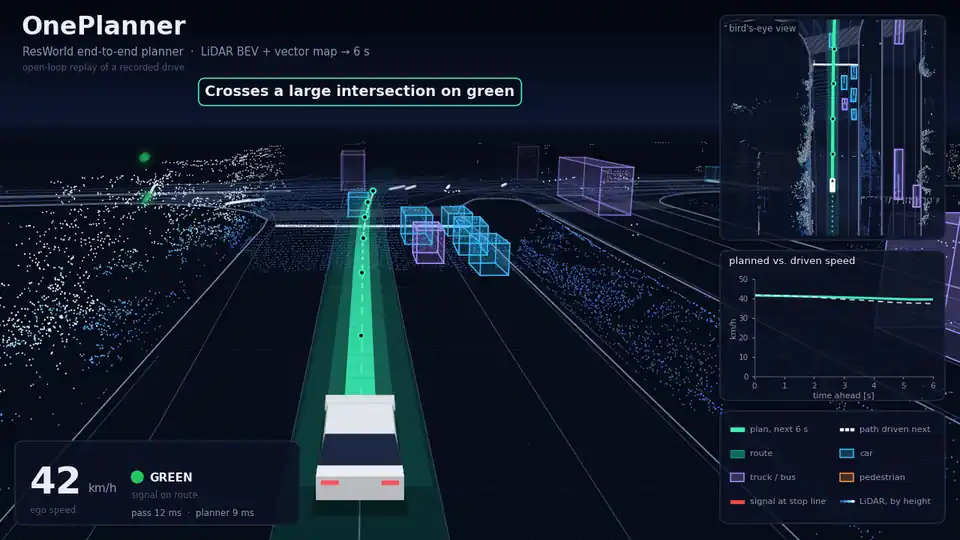
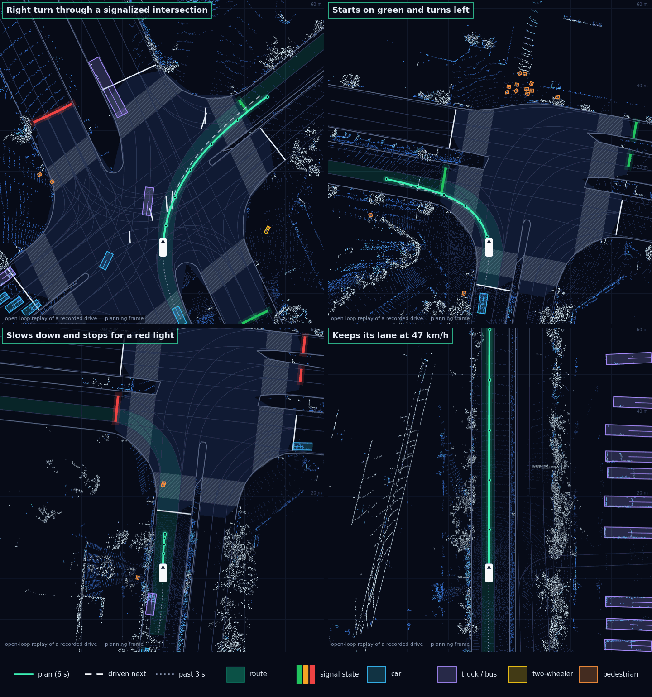

# oneplanner_ros

ROS 2 / Autoware runtime for **OnePlanner** end-to-end planning models.

`autoware_oneplanner` turns the LiDAR point cloud, the vector map, the route, traffic-light
states and the ego state into a trajectory for Autoware, running the model with TensorRT at the
LiDAR's rate. A OnePlanner model is a planner over a temporal history of LiDAR bird's-eye-view
features from a frozen BEVFusion-L backbone, with vector-map and route context.

<p align="center">
  
</p>

```text
LiDAR cloud ──► voxelization ──► BEV feature extractor ──► temporal cache + SE(2) warp ─┐
odometry, acceleration, steering ──► ego state and history ─────────────────────────────┼─► planner ──► Trajectory
map, route, traffic lights ──► lanes, route lanes, polygons, line strings, goal ────────┘
```

## Features

- **Model-driven.** The node reads the engine's input manifest and builds exactly the tensors the
  model asks for; a model whose inputs the deployment cannot produce is refused at start-up with
  the tensor's name. Switching checkpoints is a launch argument, not a code change.
- **Low latency.** The pass is driven by the point cloud callback, with no timer. The whole
  pass runs on one CUDA stream with one host synchronization. The BEV history never leaves the
  GPU, and context preprocessing overlaps feature extraction.
- **Faithful inputs.** Ego state, map conversion, traffic-light selection, the temporal BEV
  history and its SE(2) warp follow the conventions the models were trained with, documented in
  [the model contract](autoware_oneplanner/docs/model_contract.md). The warp kernel is tested
  against a PyTorch `grid_sample` reference.
- **Operable.** Start-up and runtime failures are reported on `/diagnostics` with their reason
  instead of taking the process down. The node publishes Autoware's usual per-stage timing and
  latency topics, and can dump the exact tensors a model was fed.
- **Builds on Autoware Core.** The package builds against Autoware Core and system libraries.
  It carries adapted copies of the few `autoware_universe` parts it needs, under its own
  namespace. At run time the BEV feature extractor also needs `autoware_tensorrt_plugins` from
  Autoware Universe.

## Results

<p align="center">
  
</p>

The animation and the scenes are open-loop replays of two recorded urban drives through the node
with a OnePlanner model; a person drove the vehicle. Each view is drawn in the frame the plan starts
in: the vector map, route and traffic-light states exactly as the model was fed them, the LiDAR
cloud and the objects of the extractor's detection head, the planned 6 s trajectory (the green
ribbon) and, dashed, the path the driver actually took next. The panels beside the animation show
the same frame from above and the planned speed profile against the driven one.

Timing of the node on an NVIDIA RTX PRO 6000 Blackwell Max-Q over 3,899 passes of these replays,
with the node the only planner on the GPU:

| Stage                                                                           | p50     | p95     | p99     |
| ------------------------------------------------------------------------------- | ------- | ------- | ------- |
| Whole pass, up to the published trajectory (`~/debug/processing_time_ms`)       | 12.7 ms | 18.7 ms | 26.1 ms |
| Planner inference (`~/debug/processing_time/inference_ms`)                      | 9.4 ms  | 12.5 ms | 17.0 ms |
| Context tensors: map, route, ego (`~/debug/processing_time/collect/context_ms`) | 1.5 ms  | 3.2 ms  | 5.0 ms  |

The BEV feature extraction runs in the point cloud callback before the pass and is not part of
these times; its GPU time is reported as `bev_feature.extraction_gpu_ms` on `inference_status`.

## Requirements

| Component        | Version                                                                                                                                                |
| ---------------- | ------------------------------------------------------------------------------------------------------------------------------------------------------ |
| ROS 2            | Jazzy (Humble also builds)                                                                                                                             |
| Autoware         | 2.0.0 or newer (`autoware_internal_msgs` 1.14.0 or newer)                                                                                              |
| GPU stack        | NVIDIA GPU (Turing or newer), CUDA 12 or 13, TensorRT 10                                                                                               |
| spconv           | `cumm` and `spconv` C++ libraries as Autoware installs them ([autowarefoundation/spconv_cpp](https://github.com/autowarefoundation/spconv_cpp))        |
| TensorRT plugins | `autoware_tensorrt_plugins` from [autoware_universe](https://github.com/autowarefoundation/autoware_universe), for the extractor's sparse convolutions |

Without CUDA, TensorRT or spconv the package still builds its host library and tests, but not the
node, as Autoware's other CUDA packages do.

## Build

In an Autoware workspace:

```bash
cd ~/autoware/src
git clone <this repository> oneplanner_ros
cd ~/autoware
rosdep install --from-paths src/oneplanner_ros --ignore-src -y
colcon build --packages-up-to autoware_oneplanner --cmake-args -DCMAKE_BUILD_TYPE=Release
```

## Models

The OnePlanner model is released on Hugging Face as
[AutowareFoundation/oneplanner](https://huggingface.co/AutowareFoundation/oneplanner), where its
model card describes it. Download a tagged version into the node's default model directory with
the `hf` CLI (`pip install huggingface_hub`):

```bash
hf download AutowareFoundation/oneplanner --revision v1.0 --exclude "media/*" "replay.mp4" \
  --local-dir ~/autoware_data/oneplanner
```

A model directory holds the planner graph, the BEV feature extractor graph and an
`ml_package_<model_name>.param.yaml` file that describes the network:

```text
~/autoware_data/oneplanner/
├── oneplanner_planner.onnx
├── bevfusion_lidar_feature.onnx
└── ml_package_oneplanner.param.yaml
```

Training and exporting models are not part of this repository.
[docs/model_contract.md](autoware_oneplanner/docs/model_contract.md) specifies what a model
package must provide and exactly what the node feeds it, for anyone exporting a model for this
node.

## Run

```bash
ros2 launch autoware_oneplanner oneplanner.launch.xml \
  model_path:=$HOME/autoware_data/oneplanner model_name:=oneplanner
```

The first start builds the TensorRT engines (several minutes) and caches them beside the ONNX
files. To see the output in Autoware's RViz layout, remap `output_trajectory:=/planning/trajectory`;
to drive with it, wire it into your planning stack's trajectory input behind Autoware's
trajectory validation. See the [package README](autoware_oneplanner/README.md) for the interface,
parameters and operation notes.

## Repository layout

```text
autoware_oneplanner/
├── config/        deployment defaults and an example ml_package file
├── docs/          design and model contract
├── include/, src/
│   ├── bev_feature/   voxelizer, extractor, temporal cache, SE(2) warp, detection decode
│   ├── providers/     BEV feature and context input providers
│   ├── vector_map/    lanelet2 map conversion and vector-map tensors
│   ├── postprocess/   trajectory, planning factors, detections
│   └── trt/           TensorRT engine
├── launch/        oneplanner.launch.xml
├── schema/        parameter schemas
└── test/          host tests (no GPU) and GPU tests
```

## Contributing

See [CONTRIBUTING.md](CONTRIBUTING.md) and the [Code of Conduct](CODE_OF_CONDUCT.md). Report
vulnerabilities as described in [SECURITY.md](SECURITY.md).

## License

Apache License 2.0, see [LICENSE](LICENSE). Parts adapted from
[autoware_universe](https://github.com/autowarefoundation/autoware_universe) and NVIDIA's
CUDA-BEVFusion keep their copyright notices. Read [DISCLAIMER.md](DISCLAIMER.md) before running
the planner on a vehicle.
