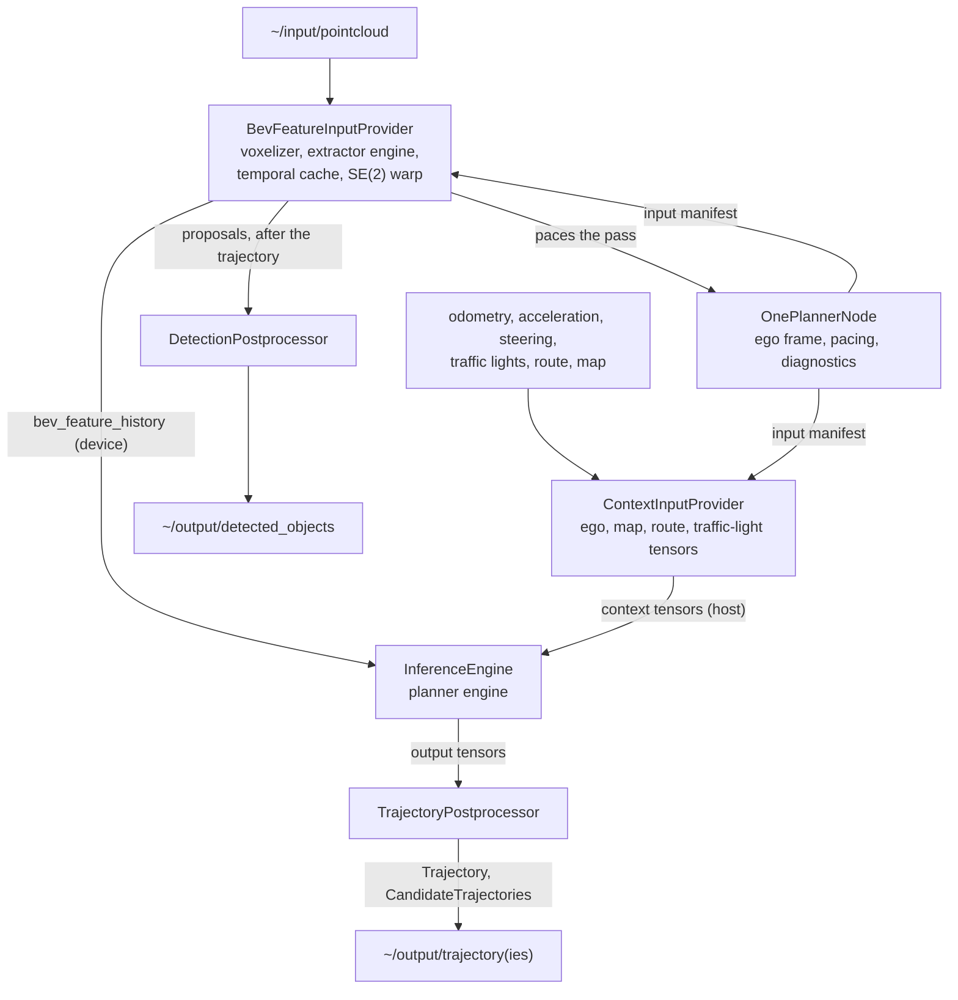

# Design

This document explains how `autoware_oneplanner` is put together and why. The interface a
model has to meet is in [model_contract.md](model_contract.md).

## Scope

The node runs one end-to-end planner graph per tick on TensorRT and publishes its trajectory to
Autoware. The planner is fed by input providers: a temporal LiDAR BEV feature history, produced
by a frozen BEVFusion-L feature extractor that is a second TensorRT engine, and the ego, map,
route and traffic-light context tensors of the diffusion-planner family.

Out of scope: training, exporting and validating models; multi-engine planner graphs; any
perception product other than the optional boxes of the extractor's detection head.

## Architecture

| Layer       | Classes                                             | Responsibility                                                  |
| ----------- | --------------------------------------------------- | --------------------------------------------------------------- |
| Node        | `OnePlannerNode`                                    | Ego state, pacing, the pass, publishers, diagnostics            |
| Providers   | `BevFeatureInputProvider`, `ContextInputProvider`   | Subscriptions and the conversion of ROS data into named tensors |
| Inference   | `InferenceEngine`, `trt::TrtEngine`                 | TensorRT engines over named tensors                             |
| Postprocess | `TrajectoryPostprocessor`, `DetectionPostprocessor` | Output tensors into Autoware messages                           |

The boundary between the layers is `TensorMap`: named tensors holding either host data or a
pointer to device-resident data. The host-side parts (context tensors, map conversion,
postprocessing) live in a library without CUDA, `autoware_oneplanner_core`, which builds and is
tested on any machine.

### The engine's input manifest drives everything

At start-up `InferenceEngine` reads the names, shapes and data types of the planner's inputs
and outputs from the engine. Each enabled provider is shown the input manifest and claims the
tensors it can produce, validating their shapes against its configuration and sizing its
buffers from them (a history length from `ego_agent_past: [1, T, 4]`, a lane count from
`lanes: [1, S, 20, 33]`). Start-up fails with a message naming the tensor when an input is
claimed by no provider or by two, or when a claimed shape contradicts the configuration. A
mismatch between a model and its deployment is a readable start-up error, not silent garbage.

Sensor providers are looked up by the names in `sensor_inputs` in a registry each provider
adds itself to from its own source file (`ONEPLANNER_REGISTER_INPUT_PROVIDER`), so a new
provider is a new source file and the node is not edited.

## The pass

**Paced by the LiDAR.** The provider reading the input the model waits on drives the pass from
its own subscription callback, the way autoware_bevfusion is driven by the same cloud. There is
no timer: a timer makes each frame wait up to a full period before it is used, latency the
controller pays for an input that had already arrived, and a tick firing between sweeps would
plan on the previous cloud and publish a trajectory indistinguishable from a fresh one. A model
no provider paces is refused.

**One CUDA stream.** The extractor, the temporal cache, the planner and the output copy are
ordered on the engine's stream, handed to each provider with `bind_stream()`. Nothing in the
middle of a pass waits for the device; the only host synchronization is the planner's wait for
its outputs (plus the voxel count the extractor needs to size its inputs). The BEV history is
read by the planner where it lies on the device; host tensors are staged into one pinned block
and cross the bus in one copy per contiguous run.

**Overlap.** The extractor is launched from the cloud callback before the pass starts, and the
pacing provider is collected last, so the context provider's CPU work (map and route tensors)
overlaps the extractor's GPU work: the pass costs the longer of the two, not their sum.

**After the trajectory.** `finish_tick()` runs once the trajectory is out: the detection head's
decode and its `~/output/detected_objects` message live there, because a consumer of the
trajectory should never wait for a message it does not read.

## BEV feature pipeline

1. **Voxelization.** The cloud is copied to the device once, turned into feature rows (x, y, z,
   intensity, time lag) and voxelized with spconv's hash voxelization, as autoware_bevfusion
   does.
2. **Extraction.** The extractor engine (sparse convolutions through `autoware_tensorrt_plugins`)
   produces the `[C, H, W]` feature map, which stays on the device.
3. **Temporal cache.** Every map is kept with the ego pose at its cloud stamp for the length of
   the history window. History steps are selected by time, not by count, so a 0.5 s history on a
   10 Hz LiDAR keeps every frame and selects every fifth one; a dropped frame is substituted by
   the next older one, as the training data indexes its scans.
4. **SE(2) warp.** Each selected map is warped into the frame the plan starts in, with bilinear
   sampling and zero padding (PyTorch `grid_sample`, `align_corners=False`). The relative
   transform is composed in double precision on the host: map coordinates reach 1e5 m, where
   float32 would quantize a slow-speed inter-frame displacement away. A golden test checks the
   kernel against a PyTorch reference (`test/generate_bev_warp_goldens.py`).

The extractor graph may carry the BEVFusion detection head. Its proposals are decoded with
autoware_bevfusion's arithmetic (TransFusion box coder, yaw-norm gate, per-(distance band,
class) score thresholds) in one kernel that also compacts the survivors, then go through
autoware_bevfusion's host steps: circle NMS, conversion to `DetectedObject`, BEV-IoU NMS and the
optional area-based class remapper. Nothing in the planner path reads them.

## Context tensors

`ContextInputProvider` produces only the tensors the manifest asks for, with
autoware_diffusion_planner's subscriptions (the same topics and QoS, polling for everything but
the map). The map conversion, lane selection and tensor writing are adapted from
autoware_diffusion_planner, reduced to the convention the OnePlanner models are trained with:
see [model_contract.md](model_contract.md#vector-map-tensors).

Under `planning_time` the map crop, slot order and route start are decided at the cloud pose,
as training decides them, and only the points written into the tensors are expressed in the
planning frame.

## Trajectory postprocessing

The prediction is interpreted as autoware_diffusion_planner interprets its own: x, y, cos(yaw),
sin(yaw) per 0.1 s step in the ego frame, agent 0 being the ego. The velocity profile is
autoware_diffusion_planner's: velocity is the distance between consecutive points over 0.1 s
(the first from the ego position), smoothed with a trailing window of
`postprocess.velocity_smoothing_window` points; a drop below `postprocess.stopping_threshold`
while the ego moves latches a stop, after which velocity is zero and the pose is held;
acceleration is the forward difference. A point at t = 0 at the ego's pose is prepended, so a
temporal follower that looks its reference up at (now - stamp) never clamps to the first
predicted point. One candidate per batch and per extra trajectory tensor is published in
`CandidateTrajectories`.

A stateless turn-indicator head answers each cycle independently and can flicker at a decision
boundary, so the node keeps the state: a new command must lead with at least
`postprocess.turn_indicator.min_probability` for `confirm_cycles` consecutive cycles, and
`hold_s` must have passed since the previous change.

## Precision

The planner engine is built with TF32 off: TensorRT otherwise runs float32 convolutions and
matrix products on TF32 tensor cores (10-bit mantissa), and a float32 planner then disagrees
with its own ONNX graph by centimetres. An exporter may write the precision into the graph
itself, keeping the metric coordinates at its two ends in float32 and the core in float16; with
`precision: "fp16"` the node then pins every layer to the dtype of its outputs and asks the
builder to obey (`kOBEY_PRECISION_CONSTRAINTS`), so the engine computes exactly what the
exporter validated. Under the plain FP16 flag the builder would be free to run the float32 rim
in half precision too. The extractor is built with TensorRT's defaults in fp16.

## Engine cache

An engine is reused only when its `.identity` file matches the SHA-256 of the graph and of the
engine, the precision, the build settings (including the optimization profile), the TensorRT
version and the GPU's compute capability. Copying an old engine next to a re-exported graph,
upgrading TensorRT or moving to another GPU therefore rebuilds instead of running the wrong
weights. Engines are written through a rename, so an interrupted build never leaves a truncated
file behind.

## Failure handling

- **Nothing that can be reported at runtime is thrown out of the constructor.** A component
  constructor that throws is not loaded at all, and the reason (a missing file, a model that
  does not match its ml_package) ends up somewhere in a container's log. The node loads,
  disables inference and reports the reason on `inference_status` once a second for as long as
  it holds. A malformed deployment still throws where rclcpp throws it (an undeclared
  `vehicle_info` or ml_package parameter), as autoware_bevfusion's read-only parameters do.
- **Waiting is not a failure.** Until the pacing sensor delivers, a 1 Hz timer reports the wait
  as WARN, naming the provider. Each status carries `<provider>.received`, the number of clouds
  the subscription has delivered, so "not receiving" and "receiving but not planning" can be told
  apart from outside.
- **No exception escapes a callback.** An exception leaving a subscription callback terminates
  the process, which may be a container shared with the sensing stack. The extraction in the
  cloud callback latches its error, and the pass, which catches, reports ERROR and stops
  planning. A CUDA error usually leaves the context unusable, so the stop is sticky.
- **Localization continuity.** A backward odometry stamp, or a pose change larger than slack plus
  maximum rate times elapsed time (`localization_reset.*`), clears the ego history and the BEV
  cache instead of warping across the jump.

## Diagnostics and debug topics

`inference_status` carries the readiness state, the reason a pass was skipped, a WARN when
processing exceeded the interval the sensor actually delivered, the received count, the
reference nodes' keys (autoware_bevfusion's `is_num_voxels_within_range`,
autoware_diffusion_planner's `valid_lane_count`, `valid_route_count`, `valid_polygon_count`,
`valid_line_string_count`), stale and duplicate cloud counts, the BEV cache's device memory and
the extraction's GPU time.

| Topic                                                                           | Content                                                       |
| ------------------------------------------------------------------------------- | ------------------------------------------------------------- |
| `~/debug/processing_time_ms`                                                    | Time of the whole pass                                        |
| `~/debug/processing_time/{total,collect,inference,postprocess}_ms`              | Per stage, autoware_bevfusion's set                           |
| `~/debug/processing_time/collect/<provider>_ms`                                 | Each provider's share of `collect_ms`                         |
| `~/debug/processing_time/finish_ms`                                             | Work done after the trajectory is out, not part of `total_ms` |
| `~/debug/cyclic_time_ms`                                                        | Time between two passes                                       |
| `~/debug/pipeline_latency_ms`                                                   | From the cloud stamp to the end of publishing                 |
| `~/debug/pipeline_latency_{p95,p99}_ms`, `~/debug/processing_time/{p95,p99}_ms` | Over the last 512 passes                                      |
| `~/debug/input_age_ms`                                                          | Age of the planning stamp when the pass starts                |
| `~/debug/sensor_latency_ms`                                                     | The `sensor_latency` fed (0 under `cloud_stamp`)              |
| `~/debug/standstill_acceleration_mps2`                                          | The acceleration fed while the ego stands still               |

`debug.dump_dir` makes the node write the host-side input and output tensors of its first
`debug.dump_max_frames` passes as raw float32 files with a JSONL manifest: what the network was
actually fed, to compare with what it was trained on.

## Extending

- **Another checkpoint of a supported model:** point `model_path` at the new model directory;
  its ml_package file describes it. No code change.
- **Another sensing input:** implement `InputProviderInterface` (`claim_inputs`, `collect`, and
  optionally `bind_stream`, `pace`, `finish_tick`, `add_diagnostics`, `latest_input_stamp`,
  `received_count`) in its own source file, register it with
  `ONEPLANNER_REGISTER_INPUT_PROVIDER("<name>", factory)` and name it in `sensor_inputs`. Submit
  GPU work on the stream from `bind_stream()` and return device tensors without synchronizing.
- **Another context feature:** extend `ContextInputProvider` with the claim, kept optional and
  driven by the manifest.

## Code adapted from Autoware

To build on Autoware Core alone, the package carries adapted copies of the parts of
`autoware_universe` it uses, under its own namespace so that they can be loaded into the same
process as the originals. All are Apache-2.0 and keep their copyright notices.

| Origin                       | Adapted here                                                                                                         |
| ---------------------------- | -------------------------------------------------------------------------------------------------------------------- |
| `autoware_diffusion_planner` | Lanelet map conversion, lane segment selection and tensors, ego history, velocity profile, planning-factor detection |
| `autoware_bevfusion`         | Voxelization, detection decode, circle and BEV-IoU NMS, class remapper, box conversion                               |
| `autoware_tensorrt_common`   | The TensorRT build configuration (`trt::TrtEngine`)                                                                  |
| `autoware_cuda_utils`        | CUDA error checking and device / pinned memory pointers                                                              |
